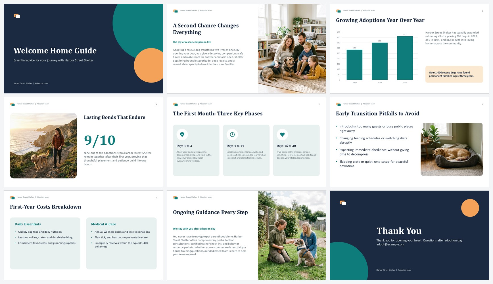
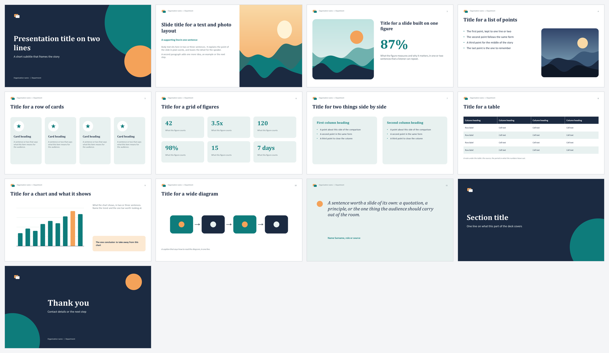
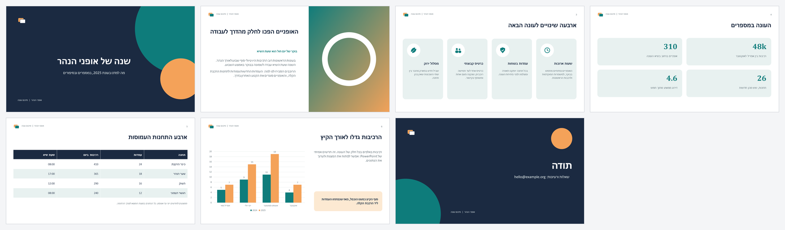

# slotdeck

Turn a PowerPoint template into new decks. A language model decides what goes on each slide; the code clones
the template's own slides and fills them, so the design is never redrawn.



*Planned, written and illustrated from a one-paragraph brief, on the demo template in this repository
([deck JSON](examples/showcase/rescue-dog/deck.json)). The shelter and its numbers are invented.*

- **Template in, decks out.** Each sample slide of a pptx becomes a reusable **pattern**. A deck picks a
  pattern per slide and supplies text and pictures for its **slots**. Everything that is not a slot (logo,
  backgrounds, fonts, decorations) is copied untouched.
- **Two layers.** A renderer that needs no model (`template + deck JSON -> pptx`), and a planner that turns a
  brief into that JSON with any model you plug in. Gemini adapters are included.
- **Editable results.** Decks are plain JSON without binary data, so they can be stored, changed by instruction
  ("shorten slide 3") and rendered again. Charts are native PowerPoint charts with their data inside.
- **Any language, either direction.** A Hebrew or Arabic deck on a left-to-right template mirrors its text and
  the order of its cards, and the other way round.
- **A studio for templates.** A model drafts the manifest that describes a template; you correct it by hand or
  by instruction; the code checks every change against the pptx.

It has two runtime dependencies (`fflate`, `@xmldom/xmldom`), no native code and no headless office.

## Install

```bash
npm install slotdeck
```

Node 22.18 or later. The package is ESM.

## Documentation

The full documentation is in [`docs/`](docs/README.md): concepts, both JSON formats, every function and option,
the chat tools, connecting your own model, the template studio, and every error message with its fix.

It is plain Markdown with no links to the internet, and it ships inside the npm package
(`node_modules/slotdeck/docs/`), so a coding assistant without network access can read it where the package is
installed. This page is the overview. What changed in each version is in
[`docs/changelog.md`](docs/changelog.md).

## How it works

A template is an ordinary deck of sample slides, the kind a designer hands over:



A **manifest** (JSON) says which slides are patterns and which shapes on them are slots, with a character
budget for each text slot. A **deck** (JSON) lists slides, each naming a pattern and giving values for its
slots:

```json
{
  "version": 1,
  "fields": { "organizationDepartment": "Riverbend Bike Share  |  Season review" },
  "slides": [
    { "pattern": "cover", "slots": { "title": "A year of Riverbend Bike Share", "subtitle": "What the 2025 season taught us" } },
    {
      "pattern": "icon-cards",
      "items": 3,
      "slots": {
        "title": "Three changes for next season",
        "card1Icon": { "asset": "clock" }, "card1Heading": "Longer hours", "card1Text": "Bikes unlock from five in the morning.",
        "card2Icon": { "asset": "shield" }, "card2Heading": "Safer docks", "card2Text": "Every station gets lighting.",
        "card3Icon": { "asset": "people" }, "card3Heading": "Group passes", "card3Text": "One pass for up to five riders."
      }
    }
  ]
}
```

```ts
import { loadTemplate, renderDeck } from 'slotdeck';

const template = loadTemplate(pptxBytes, manifest); // unzip once, reuse for every deck
const { pptx, warnings } = renderDeck(template, deck, { assets: { clock, shield, people } });
```

That is the whole renderer: no model, no network, about 100 ms for a 15-slide deck.

## Generate a deck with a model

```ts
import { gemini, geminiImages, generateDeck, loadTemplate } from 'slotdeck';

const template = loadTemplate(pptxBytes, manifest);

const { pptx, deck, warnings } = await generateDeck(
  template,
  {
    prompt: 'A deck for new adopters: why adopt a rescue dog, the first month at home, what it costs',
    language: 'en',
    slideCount: 9,
    imageDensity: 'medium', // none | low | medium | high
    fields: { organizationDepartment: 'Harbor Street Shelter  |  Adoption team' },
  },
  {
    llm: gemini({ model: textModel, apiKey }),
    images: geminiImages({ model: imageModel, apiKey }),
    icons: [{ id: 'clock', description: 'a clock: time, schedule', data: clockPng }],
    assets: [{ id: 'flow', kind: 'graphic', description: 'adoption process diagram', data: mermaidPng }],
    layout: 'adaptive', // or 'strict'
    onProgress: (event) => console.log(event.stage),
  },
);
```

`generateDeck` is three steps you can also call yourself:

| Step | Function | Model calls |
| --- | --- | --- |
| Brief to deck JSON | `planDeck` | 2, plus up to 2 repair rounds |
| Deck JSON and instruction to deck JSON | `planEdit` | 1 or 2, plus up to 2 repair rounds |
| Deck JSON to picture bytes | `resolveAssets` | one per generated photo |
| Deck JSON and pictures to pptx | `renderDeck` | none |

Keep the returned `deck`. It is plain JSON with no binary data, so it can be stored, changed and rendered again.
Pass the same `cache` map to later calls and photos whose description did not change are not generated twice.

**Icons** come from a set your app registers, and the model picks among them by description. **Photos** come
from an image source you plug in. **Supplied pictures** (`assets`) are for things your app already has, such as
a rendered Mermaid diagram.

### How planning works

1. **Outline.** The model sees the template's patterns with their slot limits and picks one per slide.
2. **Content.** The model fills a JSON schema built for exactly that sequence of slides, so it cannot invent
   patterns or slots.
3. **Repair.** The draft is checked against the manifest. Text over a slot's budget or a missing slot goes back
   to the model with the list of problems.

Patterns the caller cannot fill are never offered: photo patterns when images are off, icon patterns without an
icon set, patterns that need a deck field that was not given.

Patterns built around numbers (`"figures": true` in the manifest) are offered only when the brief itself
contains figures. In a live run without this guard the model filled such a slide with an invented statistic. Set
`numberPatterns: 'always'` to offer them regardless, or `'never'` to rule them out. Chart values the brief does
not state come back as warnings (`chart values not stated in the brief: 89`).

A wish about the kind of slides, such as "text only" or "no tables", decides which patterns may be used and
comes before variety. For a deck of text and nothing else, set `textOnly: true` on the brief (`text_only` in the
chat tool): only the template's plain text patterns are then offered.

### Editing a deck

```ts
import { editDeck, extractAssets } from 'slotdeck';

// The deck JSON and the pptx rendered from it are all that has to be stored between turns:
// the pictures are read back from the file instead of being generated again.
const cache = new Map(Object.entries(extractAssets(template, deck, previousPptx)));

const { pptx, deck: next, summary, rewritten } = await editDeck(template, deck, 'Shorten slide 3 to two bullets', {
  llm,
  images,
  icons, // the same icon set and assets the deck was made with
  cache,
});
```

An edit is two model calls. The first decides what the deck looks like after the change: which slides stay,
move, go, get rewritten or are new. The second writes only the slides that change. Reordering and deleting need
no second call.

- Slides the instruction does not touch are copied by code, so their text cannot drift.
- A rewritten slide keeps its pictures unless the instruction is about them.
- A slide given a different layout takes its photo along.
- A change of language rewrites every slide, sets the reading direction and translates deck-level texts.
- `summary` is one sentence from the model on what it did, to show the person who asked.

Changes made by hand in PowerPoint are not read back: the deck JSON is the source of truth.

### Chat tools

For a chat app, the package provides the four tools a model needs to make a deck with a person in the loop:

| Tool | What it does | Model calls |
| --- | --- | --- |
| `plan_presentation` | Decides the slides, the layout of each and the point each makes | 1 |
| `edit_presentation_plan` | Changes a plan by instruction | 1 |
| `create_presentation` | Writes the approved plan's content, makes its pictures, renders the file | 1, plus repairs and pictures |
| `edit_presentation` | Changes a created deck by instruction | 1 or 2, plus repairs |

```ts
import { presentationTools } from 'slotdeck';
import { directoryStore } from 'slotdeck/node';

const tools = presentationTools({
  template,
  llm,
  images, // optional: without it decks are planned with no photos
  icons,
  store: directoryStore('/mnt/presentations'), // a volume, or any object with get(key) and set(key, bytes)
  fields: { organizationDepartment: 'Harbor Street Shelter  |  Adoption team' },
  thumbnail: (pattern) => `/static/thumbnails/${pattern}.png`,
});

// Declare the tools to the chat model (Interactions format shown):
const declarations = tools.definitions.map((tool) => ({ type: 'function', ...tool }));

// Run a tool the model called:
const { output, plan, deck, pptx } = await tools.call(call.name, call.arguments);
// `output` goes back to the model; `plan`, `deck` and `pptx` are for the app's own UI.
```

The model only ever handles ids and short summaries. Everything else is kept in the store:

| Key | Content | Typical size |
| --- | --- | --- |
| `plan/<id>.json` | A plan: the brief and the slide list | 1 KB |
| `deck/<id>.json` | A deck: all text, and for each picture its id and description | 4 KB |
| `asset/<id>` | One picture | tens of KB to 1 MB |
| `pptx/<id>.pptx` | The rendered file | 1 MB and up |

Pictures are stored once, apart from the JSON and the file. A deck's JSON never holds image bytes, so no heavy
data reaches a model, and a pptx can be rebuilt from the JSON and the pictures at any time. Every change makes a
new plan or deck under a new id; earlier versions stay.

To show a plan as layout thumbnails, render the template once and name the pictures after the patterns
(`scripts/pattern-thumbnails.ts`). A derived pattern, such as a mirror image, looks different from the slide it
comes from: `scripts/template-deck.ts` writes a deck with one slide per pattern, filled with the template's own
sample content, to take those pictures from. `examples/plan-preview.ts` turns a plan into a self-contained page.

### Other models

A text model is anything with this method:

```ts
const llm: LlmProvider = {
  async generateJson({ system, prompt, schema, images, signal }) {
    return myModel.json({ system, prompt, schema }); // resolve with the parsed JSON
  },
};
```

An image source is anything with `generateImage({ prompt, kind, aspectRatio })` that resolves with PNG, JPEG or
GIF bytes. It can be an image model, a stock library or a search.

The Gemini adapters call the Interactions API with plain `fetch`. For Vertex AI, pass
`endpoint: vertexEndpoint(project)` and a `headers` function that returns a bearer token. A request that has
not answered after three minutes is abandoned with an error; `timeoutMs` changes the limit.

## Languages and direction

A deck states its language and reading direction; the template has its own. When they differ, text flips and
the layout stays:



- Every paragraph gets the direction of its own text, so a Hebrew deck may hold an English line.
- Alignment mirrors (`alignOnDirectionChange: 'flip'`, for the whole template or per slot). Templates whose text
  boxes share one edge but not the other can `keep` it.
- Rows and grids of items are filled mirror-wise, so the deck's first card is where its readers start.
- Tables and charts run in the deck's direction.
- Right-to-left runs are marked with their language, because PowerPoint places punctuation by the language of a
  run: without it, the colon in "contact: name@example.org" lands on the wrong side of the address.
- Shapes do not move. A photo on the right stays on the right.

## Templates

- **Manifest** (`TemplateManifest`): which slides are patterns and which shapes are slots. See
  [`templates/demo.manifest.json`](templates/demo.manifest.json).
- **Layout**: `strict` requires every slot to be filled. `adaptive` lets optional slots be left out, and removes
  their shapes.
- **Empty slots**: each slot says what happens without a value. `error` makes it required, `remove` makes it
  optional, `keep` leaves the template's content, and `drop` always removes it (for a sticker drawn onto a
  particular sample photo).
- **Deck fields**: a text that is the same on every slide, such as the organization line beside the logo, is
  one value for the whole deck (`fields`).
- **Tables**: a table slot takes `{ header, rows }`. The sample table's rows supply the styles (header, then the
  body rows in turn), columns share its width, and it runs in the deck's reading direction.
- **Supplied pictures**: a `graphic` slot is filled from the `assets` the app passes. The picture keeps its
  proportions inside the frame; `box` gives it a larger area than the sample picture's.
- **Charts**: a chart slot takes `{ type, categories, series, format }` and becomes a native PowerPoint chart
  (`column`, `bar`, `line` or `pie`) with its data in an embedded workbook, so it can be changed with Edit Data.
  The slot points at the sample picture of a chart, which the real chart replaces. Colours, font and line colour
  come from the manifest. Bars start at zero.
- **Number patterns**: `figures: true` marks a pattern built around numbers.

### Layout freedom

A deck can depart from the template slide in bounded ways. In each, the model chooses among options the
manifest allows and the code moves the shapes; the model never positions anything.

- **A different number of items.** A pattern with `repeat` names the shapes that make one card and the range it
  accepts (in the demo template `icon-cards` takes 2 to 4 and `stat-cards` 2 to 6). A slide says how many with
  `items`. Surplus cards are removed, extra ones are copies of the last, and the row is spaced out again around
  its centre. A copied card has its own slots (`card5Icon`, `card5Heading`, ...).
- **Grids.** With `columns`, the items form a grid. They take as few rows as they need and spread evenly: four
  figures in a three-column grid make two rows of two, five make three and two, three make one row.
- **Larger text.** `textScale` on a deck (or `textSize: 'large' | 'x-large'` on a brief) enlarges body text:
  slots of 12 pt and under by default, not titles. Because the boxes stay the same size, character budgets fall
  with the square of the scale, so the model writes less. A template whose own body text is small can be
  enlarged once for every deck with `textScale` on the manifest.
- **Derived patterns.** Several patterns can come from one slide. A text slot can be moved and resized (`box`),
  given a font size (`fontSize`) and paragraph spacing, and any shape can be dropped. In the demo template
  `text-only` is the photo slide with its photo dropped and its text widened, and `chart-native` is the chart
  slide with a native chart in place of the picture.
- **Variants the code works out.** For three common variants nobody types a box: the mirror image of a slide
  with a picture, the same slide without its picture, and a slide without one of its optional lines. One
  operation (`derivePattern`) makes each, moving the shapes and measuring the budgets again; the header, logo
  and page number stay where they are. In the demo template `text-and-photo-mirrored`, `photo-stat-mirrored`
  and `list-with-photo-mirrored` were made this way.

## Template studio

Writing a manifest by hand means reading shape ids out of a pptx. The studio functions do that work with a
model, and keep the model from breaking anything.

```ts
import { checkManifest, draftManifest, gemini, loadTemplate, renderDeck, sampleDeck } from 'slotdeck';

// 1. Draft: one model call per slide, plus one for the deck.
const { manifest, skipped, issues } = await draftManifest(pptx, {
  llm: gemini({ model: textModel, apiKey }),
  name: 'marketing',
  slideImage: (slide) => thumbnails.get(slide), // optional PNG or JPEG of each slide; may be async
  onProgress: ({ done, total }) => report(done, total),
});

// 2. Check: after every change to the manifest, and whenever a template is loaded.
const template = loadTemplate(pptx, manifest);
const problems = checkManifest(template);

// 3. Look: every pattern once, every slot filled close to its budget.
const { deck, assets } = sampleDeck(template);
const sample = renderDeck(template, deck, { assets }).pptx;
```

**`draftManifest`** splits the work so that the model cannot break the manifest. The code measures: every
shape's id, kind, position, font size and sample text; what sits in the same place on many slides (logo, page
number: left alone); texts that repeat across slides (deck fields); the reading direction; a character budget
for each text box from its size and font; a table's columns, rows and cell size; and rows or grids of like
items, from numbered slot names. The model answers two things for each slide: whether it is a reusable layout
at all, and what role each shape plays (`title`, `text`, `list`, `number`, `photo`, `icon`, `graphic`, `table`,
`decoration`, or `fixed`). A label for a shape that is not on the slide is discarded, and the result is run
through `checkManifest` before it is returned.

**`checkManifest`** reports slots that point at a missing shape or the wrong kind of shape, duplicate names,
rows whose items do not line up with their slots, and text slots with no budget. It reads only the pptx and the
manifest, so it is safe to run on every load.

**`sampleDeck`** uses the template's own filler words, so the result reads like the template with every box
full. Text that overflows in the sample will overflow in real decks. `items: 'max'` fills rows to their largest
count, `fill` sets how close to the budget each slot goes.

### Changing a manifest

A manifest is changed through small operations. A studio screen sends them from its own controls, and
`editManifest` has a model turn an instruction into the same operations. Either way the code checks each
operation against the pptx, measures what follows from it, and refuses what cannot work.

```ts
import { changeManifest, editManifest, studioView } from 'slotdeck';

// By hand: one operation or many.
const result = changeManifest(template, [
  { op: 'copyPattern', pattern: 'chart-with-takeaway', id: 'chart-native' },
  { op: 'addSlot', pattern: 'chart-native', shape: '6', role: 'chart' }, // the sample picture becomes a native chart
  { op: 'setRepeat', pattern: 'stat-cards', min: 2, max: 6 },
  { op: 'setSlot', pattern: 'table', slot: 'table', maxColumns: 5, bodyText: { size: 12 } },
]);
result.manifest; // the new manifest; the template that was passed in is not touched
result.applied;  // [{ index, change, message }]
result.rejected; // [{ index, change, reason }]  "5 cards do not fit side by side: ... The most is 4"
result.issues;   // checkManifest on the result

// By instruction, in any language.
const edited = await editManifest(template, 'Rename four-icon-cards to icon-cards and make the card icons required.', { llm });
edited.note; // what the model could not do, in the person's language; usually empty

// For a screen: every slide's shapes with their place on the slide, their slots, and the roles they can take.
const view = studioView(template);
```

| Operation | What it changes |
| --- | --- |
| `setSlot` | A slot's budget, whether it is required, optional, kept or always removed (`empty`), font size, area (`box`), name, deck field, picture kind, and the settings of a table or chart. |
| `addSlot` | Makes a shape a slot in a role (`title`, `text`, `list`, `number`, `caption`, `photo`, `icon`, `graphic`, `chart`, `table`, `decoration`), with limits measured from the shape. On a shape that is already a slot it changes the role. |
| `removeSlot` | The shape goes back to being part of the design. |
| `setRepeat`, `removeRepeat` | How many items a row or grid takes. Finds the row from numbered slot names when the pattern has none. |
| `addPattern`, `copyPattern`, `setPattern`, `removePattern` | Which slides are patterns, their ids and descriptions, and variants of a pattern from the same slide. |
| `derivePattern` | A variant of a pattern that the code lays out by itself: `mirror`, `text-only`, or `without` an optional text. Refused with the reason when the slide does not allow it. |
| `setManifest` | The template's name, language, direction and alignment policy. |

What the code adds to each change:

- **Budgets follow.** A new font size, text area, table text size or column count changes the character budget,
  unless the change states one.
- **Rows are checked for room.** Asking for more items than the row draws widens it as far as the slide allows,
  up to the margin or the next shape beside the row. Asking for more than fit is refused with the most that do.
- **Row items stay alike.** A change to `card1Icon` is made to that slot of every card.
- **Nothing is left broken.** A change that would make the manifest point at something the pptx does not have
  is refused, and the rest of the list is still applied.

`editManifest` makes one model call, and a second when some of its operations were refused, so the model can
correct them. The model never sets a position: `box` and `span` exist only for changes made by hand, and a
variant it asks for by name is laid out by the code.
`describeManifest(template)` returns the text the model reads, for an app that wants to show the manifest to its
own chat model.

### How the demo manifest was made

`templates/demo.manifest.json` was made with these functions, not written by hand:

1. `draftManifest` on the 13 slides, with a 480-pixel picture of each: 14 model calls, 29 seconds. All 13
   slides became patterns, with the row of cards, the grid of figures, the two columns and the organization
   line found, and no checker issue.
2. One instruction to `editManifest` renamed five patterns, made the card icons and texts required and added the
   native-chart variant. It also asked for five cards in a row; that was refused, because four fit.
3. A few changes by hand with `changeManifest`: the text-only variant, chart colours, mirrored alignment for
   right-to-left decks, and tighter budgets for figures and one-line captions.
4. Three `derivePattern` operations for the mirror images of the slides with a photo.

A draft is a starting point. What it does not contain, and a person adds while reviewing: budgets tuned by eye,
derived patterns, wider rows, picture areas and chart colours. On a 36-slide corporate template (not included
here) the draft took 37 calls and 80 seconds, skipped the 12 slides that were not layouts, and matched a
hand-written manifest on 114 of 115 slots.

## Try the examples

```bash
git clone https://github.com/renanbazinin/slotdeck.git
```

```bash
npm install
```

```bash
npm test
```

Render the example decks (no model, no key). They are written to `out/`:

```bash
npm run demo
```

Generate a deck with Gemini. Put `GEMINI_API_KEY=...` in a `.env` file first:

```bash
node --env-file=.env examples/generate-demo.ts "A deck about adopting a rescue dog" --slides 6
```

Photos are free drawn stand-ins unless you add `--real-images`, which calls the paid image model. `--lang he`
writes in another language, `--charts` supplies two sample charts the way an app would supply its own diagrams,
and `--dry-run` prints the prompts without calling anything.

Change a deck that was generated earlier:

```bash
node --env-file=.env examples/edit-demo.ts out/a-deck-about-adopting-a-rescue-dog.deck.json "Shorten slide 3 to two bullets"
```

Play a chat app that calls the four tools in turn:

```bash
node --env-file=.env examples/tools-demo.ts "A deck about adopting a rescue dog"
```

Draft a manifest for a template of your own, then change it by instruction:

```bash
node --env-file=.env examples/studio-demo.ts draft path/to/template.pptx
```

```bash
node --env-file=.env examples/studio-demo.ts edit "make the subtitle optional on every slide"
```

List the shapes of a template's slides, as the manifest addresses them:

```bash
node scripts/inspect.ts templates/demo.pptx --slides 2,5
```

On Windows with PowerPoint installed, this exports every slide of a deck to PNG, which is how the pictures on
this page were made:

```bash
powershell -File scripts/render-pptx.ps1 -Path out/patterns-en.pptx -OutDir out/png/patterns-en
```

## What to know before relying on it

- **Shapes need their own position.** The engine measures the shapes on a slide. A shape that takes its position
  and font size from a layout placeholder, without stating them on the slide, is filled correctly but measured
  as empty, so its budget is only as long as its sample text. Decks exported from Google Slides and decks built
  from free-standing text boxes work as they are.
- **Budgets are estimates.** A character budget cannot see lines lost to wrapping. Budgets for slots with several
  paragraphs should be set with room to spare, and a sample deck is the way to see them.
- **Models invent details.** In the showcase deck the model made up an email address and a phone number for the
  closing slide, which were replaced by hand. Figures are guarded (see How planning works); contact details and
  names are not.
- **What has been run.** The whole path was run against the Gemini Developer API with `gemini-3.8-flash` for
  text and `gemini-3.1-flash-image` for photos, in English and Hebrew. Vertex AI is supported by the adapter but
  has not been run live. Output was checked by rendering in PowerPoint on Windows; other viewers were not tested.
- **Not built:** stacked or combined charts, speaker notes, and reading back changes made in PowerPoint.

## The demo template and pictures

`templates/demo.pptx` and the icons in `examples/icons` are drawn by
[`scripts/build-demo-template.py`](scripts/build-demo-template.py): no stock photo, logo or icon from anywhere
else is in them. The four photos of the showcase deck were generated once with an image model from the
descriptions in its JSON. All of it is covered by the license below and free to reuse.

## License

MIT
